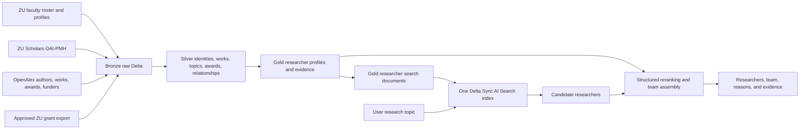

# ResearchMatch AI — Product and Data Plan

**Status:** Current source of truth  
**Last updated:** 2026-08-20  
**Platform:** Databricks Free Edition  

This MVP builds evidence-based profiles of active Zayed University researchers and matches a user-supplied research topic to suitable ZU collaborators or a complementary research team.

## 1. Product outcome

ResearchMatch AI will answer:

> “Given this research topic, which Zayed University researchers should I collaborate with, and why?”

For every researcher, the product should show:

- current ZU role, college, and department or teaching area;
- research outputs, including articles, books, chapters, conference papers, datasets, and other repository works;
- primary and emerging research interests inferred from completed work;
- research methods or capabilities when the evidence supports them;
- historical grants and awards, with source and confidence clearly shown;
- recent activity and selected impact indicators;
- previous collaborators and interdisciplinary experience;
- links to the evidence used to construct the profile.

For every topic query, the product should return:

- ranked individual researchers;
- an optional suggested team of complementary researchers;
- concise reasons for each recommendation;
- relevant publications and grant evidence;
- confidence and data-quality indicators;
- filters such as college, campus, activity window, and team size.

## 2. MVP scope

### Included

- Active ZU faculty and research-active academic administrators.
- Adjunct faculty retained in the data and included only when product policy allows it.
- ZU faculty pages, ZU Scholars, OpenAlex, and approved institutional grant data.
- Publicly verifiable researcher identifiers and research metadata.
- Research-interest inference from structured topics, titles, abstracts, subjects, and recency.
- Topic-to-researcher retrieval using Databricks AI Search.
- Evidence-backed ranking and team assembly.
- Bronze, Silver, and Gold Delta tables in Unity Catalog.

### Not included in the MVP

- Searching for future funding opportunities.
- Matching to researchers outside Zayed University.
- Grant application writing or submission.
- Treating citation count as a measure of researcher quality.
- Claiming that public grant metadata is a complete financial record.
- Downloading publication PDFs or grant attachments without explicit permission.
- Building profiles primarily from an LLM's unsupported interpretation.

## 3. High-level architecture



## 4. Source strategy

### 4.1 Researcher roster

Source priority:

1. Official ZU HR or Office of Research export, if available.
2. Public ZU college faculty listing and profile pages.

The roster determines who is currently in scope. OpenAlex institution affiliation must not be used as proof of current employment because it includes historical, incidental, and incorrectly attributed affiliations.

Required roster fields:

- institutional researcher ID, if available;
- full name and known aliases;
- institutional email;
- college, department, campus, rank, and role;
- active/inactive status;
- ORCID and public profile URL, when available;
- effective or extraction date.

### 4.2 Research outputs

Use ZU Scholars as the institutional publication source and OpenAlex for enrichment.

ZU Scholars supplies:

- repository identifier and URL;
- title, creators, abstract, date, subjects, and content-type sets;
- DOI and public file URL when present;
- college and collection membership through OAI set specifications.

OpenAlex supplies:

- canonical work and author IDs;
- ORCID links and name alternatives;
- authorships and affiliation evidence;
- structured topic, subfield, field, and domain labels;
- abstracts where available;
- venue, work type, open-access status, citations, and publication dates;
- coauthor relationships;
- award and funder links when available.

DOI is the preferred work crosswalk. Works without DOIs require title, year, and author matching with confidence scoring.

### 4.3 Grants and awards received

Grant history needs an explicit confidence hierarchy.

| Priority | Source | Treatment |
|---|---|---|
| 1 | Approved ZU Research Office grant/award export | Authoritative confirmed award |
| 2 | Direct funder award page linked to the researcher or ZU | Confirmed public award |
| 3 | OpenAlex Award record with matching award ID, investigator, institution, or funded output | Externally evidenced; verify association |
| 4 | Structured funding acknowledgement on a publication | Publication-level funding evidence |
| 5 | Faculty biography or CV statement | Self-reported; review before confirmation |
| 6 | LLM/rule extraction from unstructured text | Candidate evidence only; never automatically confirmed |

The institutional export should contain, when approved:

- internal award ID and external funder award ID;
- project title and abstract;
- funder and funding program;
- principal investigator and co-investigators using institutional IDs;
- award amount, currency, and ZU share when disclosure is allowed;
- start date, end date, and status;
- internal/external and grant type;
- source-updated timestamp and visibility classification.

OpenAlex has a dedicated Awards API containing award title, description, funder, award ID, scheme, type, amount/currency, dates, investigators, awarded institutions, funded outputs, topics, provenance, and source URL. Its own documentation warns that award-to-work and award-to-funder matching can be incomplete. A live ZU institution query on 2026-08-20 returned only one award and its lead affiliation did not appear to be ZU, confirming that OpenAlex alone is insufficient for ZU grant history. [OpenAlex Awards documentation](https://help.openalex.org/data/awards/)

If an official ZU grant export is unavailable, the UI must say **“publicly evidenced funding”**, not **“all grants received.”** Amount totals should not be shown as complete.

## 5. Medallion data model

Use these Unity Catalog schemas:

- `workspace.researchmatch_bronze`
- `workspace.researchmatch_silver`
- `workspace.researchmatch_gold`

### 5.1 Bronze: source-faithful history

Bronze remains versioned and reprocessable. Store selected raw business payloads plus source metadata, hashes, request context, and ingestion-run IDs.

| Table | Grain |
|---|---|
| `ingestion_runs` | One source ingestion execution |
| `ingestion_errors` | One request or record error |
| `zu_faculty_pages_raw` | One fetched HTML page version |
| `zu_faculty_discovered_profiles` | One discovered profile link/version |
| `zu_scholars_oai_raw` | One OAI record version |
| `zu_grant_awards_raw` | One version of an approved institutional award record |
| `openalex_institutions_raw` | One OpenAlex institution version |
| `openalex_authors_raw` | One OpenAlex author version |
| `openalex_works_raw` | One OpenAlex work version |
| `openalex_awards_raw` | One OpenAlex award version |
| `openalex_funders_raw` | One OpenAlex funder version |

### 5.2 Silver: canonical research graph

| Table | Grain and purpose |
|---|---|
| `researchers` | One canonical ZU researcher |
| `researcher_identifiers` | One ORCID, OpenAlex, institutional, email, or repository identifier per researcher |
| `researcher_aliases` | One normalized name variant per researcher |
| `researcher_affiliations` | One affiliation period/source per researcher |
| `works` | One deduplicated research output |
| `researcher_works` | One researcher-work authorship relationship |
| `topics` | One OpenAlex topic with hierarchy |
| `work_topics` | One work-topic score |
| `researcher_topic_scores` | One researcher-topic score by scoring version |
| `coauthor_edges` | One researcher pair with collaboration statistics |
| `funders` | One canonical funder |
| `awards` | One canonical grant/award |
| `researcher_awards` | One researcher-award role and confidence relationship |
| `award_evidence` | One source assertion supporting or contradicting an award relationship |
| `entity_resolution_review` | One ambiguous identity or award association requiring review |

Important Silver fields:

- stable surrogate IDs independent of mutable names;
- source provenance and source record IDs;
- match method and confidence;
- first/last observed timestamps;
- verification status;
- active/current flags;
- record-quality indicators.

### 5.3 Gold: product-ready profiles

| Table | Grain and purpose |
|---|---|
| `researcher_profiles` | One current profile per researcher |
| `researcher_profile_publications` | Ranked publication evidence for each profile |
| `researcher_profile_awards` | Confirmed and evidenced award summaries |
| `researcher_profile_topics` | Ranked expertise topics with evidence and recency |
| `researcher_match_features` | Structured activity, collaboration, breadth, and grant-experience features |
| `researcher_search_documents` | One AI Search source row per searchable researcher |
| `profile_quality_metrics` | Coverage, freshness, confidence, and unresolved-data measures |

Gold tables must be reproducible from Silver. Human corrections belong in a governed mapping/override input, not as undocumented manual edits to Gold.

## 6. Researcher identity resolution

The roster defines the canonical person. Link evidence in this order:

1. institutional researcher ID;
2. exact ORCID;
3. exact institutional email;
4. DOI authorship with ZU affiliation and compatible name;
5. OpenAlex author ID verified by multiple works or affiliation evidence;
6. normalized name plus college, topics, and publication evidence;
7. manual review for ambiguous cases.

Do not merge researchers using name similarity alone. Common names, name order, initials, transliteration, and author-profile splitting/merging make this unsafe.

Recommended identity statuses:

- `verified`
- `probable`
- `ambiguous`
- `unmatched`
- `rejected`

Only `verified` and high-confidence `probable` links feed public profiles. Ambiguous links remain reviewable evidence.

## 7. Inferring research interests

Research interests should be derived from evidence, not generated from a biography alone.

### Signals

- OpenAlex work-topic scores and topic hierarchy;
- ZU Scholars subjects;
- titles and abstracts;
- publication type;
- recency;
- authorship contribution where available;
- frequency across independent works;
- stated research/teaching areas from ZU profiles;
- topics of verified historical awards.

### Topic score

For each researcher and topic, calculate a versioned score such as:

```text
sum(
  source_topic_score
  × recency_weight
  × authorship_weight
  × work_type_weight
  × source_confidence
)
```

Recommended behavior:

- use a roughly five-year half-life so recent work matters without erasing established expertise;
- preserve an all-career score and a recent score;
- reduce the effect of extremely large consortium papers on individual expertise;
- require evidence from more than one work before presenting a topic as established expertise;
- label a topic as emerging when it is recent but has limited evidence;
- use OpenAlex topics/subfields/fields as the stable taxonomy;
- retain profile-stated interests separately so users can distinguish stated from demonstrated interests.

### Profile summary

Build a deterministic evidence bundle first. An LLM may turn that bundle into readable prose, but every sentence must be traceable to structured fields or cited works/awards. Store the prompt version, generation timestamp, source evidence IDs, and model identifier. If no suitable model is available in Free Edition, use a templated summary instead.

## 8. AI Search design

Databricks Free Edition permits one AI Search endpoint with one search unit and does not support Direct Vector Access. Use one standard Delta Sync index with managed embeddings and triggered synchronization. [Databricks Free Edition limitations](https://docs.databricks.com/aws/en/getting-started/free-edition-limitations)

### Endpoint and index

- Endpoint: `researchmatch-search`
- Index: `workspace.researchmatch_gold.researcher_profiles_index`
- Source table: `workspace.researchmatch_gold.researcher_search_documents`
- Primary key: `document_id`
- Embedding source: `search_text`
- Index subtype/query mode: hybrid semantic and keyword
- Sync mode: triggered after a successful Gold refresh
- Change Data Feed: enabled on the source Delta table
- Row grain: one document per active searchable researcher

A standard Delta Sync source requires Change Data Feed, and Databricks can compute managed embeddings from a text column. [Databricks AI Search creation guide](https://docs.databricks.com/aws/en/ai-search/create-ai-search)

### Search document shape

| Column | Purpose |
|---|---|
| `document_id` | Stable key such as `researcher:<researcher_id>` |
| `researcher_id` | Gold/Silver join key |
| `display_name` | Result display and keyword matching |
| `title`, `college`, `department`, `campus` | Display and filters |
| `active_flag` | Hard filter |
| `primary_fields` | Broad expertise labels |
| `top_topics` | Fine-grained expertise labels |
| `methods_text` | Demonstrated/stated methods |
| `award_experience_text` | Verified/evidenced funded-project experience |
| `search_text` | Curated text sent to the managed embedding model |
| `profile_quality_score` | Result confidence signal |
| `latest_research_year` | Activity filter/reranking |
| `profile_url` | Evidence/display link |
| `updated_at` | Freshness |

`search_text` should contain the researcher's evidence-backed research summary, primary topics, methods, selected recent/relevant work titles, and verified award themes. Keep it concise and stable; detailed publication and award rows stay in separate Gold tables and are joined after retrieval.

## 9. Topic matching and team formation

### 9.1 Candidate retrieval

1. Accept the user's topic in natural language.
2. Optionally collect methods, desired team size, college/campus constraints, and whether the user should be excluded.
3. Query AI Search in hybrid mode against `search_text`.
4. Filter to active researchers and any user constraints.
5. Retrieve a candidate pool, for example the top 20–40 researchers.

### 9.2 Structured reranking

Rerank AI Search candidates using transparent features. Initial weights are hypotheses and must be tuned through evaluation.

| Component | Initial weight |
|---|---:|
| Semantic/hybrid retrieval relevance | 50% |
| Direct structured topic overlap | 20% |
| Recent relevant work | 10% |
| Strength and number of relevant evidence works | 10% |
| Relevant verified/evidenced grant experience | 5% |
| Profile completeness and identity confidence | 5% |

Do not allow citations, h-index, rank, college, or grant amount to dominate matching. These signals are field-dependent and can introduce strong disciplinary bias.

### 9.3 Team assembly

When the user requests a team rather than individuals:

1. choose the strongest lead-topic match;
2. add candidates that cover missing subtopics or methods;
3. penalize near-duplicate expertise using maximal marginal relevance or an equivalent diversity rule;
4. optionally reward demonstrated cross-college or cross-topic collaboration;
5. avoid using prior coauthorship as a requirement, because the product should also enable new collaborations;
6. explain the role each proposed member could play.

Team output should distinguish:

- subject/domain lead;
- methods or technical specialist;
- complementary application-area researcher;
- optional experienced grant/project lead when verified evidence exists.

### 9.4 Match response

Each returned researcher should include:

- match score or qualitative fit band;
- two or three evidence-based reasons;
- top relevant topics;
- up to three relevant works with links and dates;
- relevant grant/award evidence with verification label;
- current college/role and profile link;
- data freshness and confidence.

Never present generated explanations without the evidence rows used to support them.

## 10. Application shape

The MVP can be one Databricks App with:

- a topic input box;
- optional filters and team-size control;
- individual/team result toggle;
- researcher cards;
- expandable evidence for works, awards, and topic scores;
- feedback controls such as relevant/not relevant and incorrect profile data.

The application reads candidates from AI Search and fetches full evidence from Gold Delta tables through the SQL warehouse.

Lakebase is not required for the core matching data. If saved searches, bookmarks, feedback, or user sessions are added, Lakebase may hold only that transactional app state; research profiles and matching evidence remain in Delta.

## 11. Refresh and orchestration

Recommended MVP cadence:

| Dataset | Cadence |
|---|---|
| ZU roster and public profiles | Weekly or after official roster delivery |
| ZU Scholars OAI-PMH | Weekly full reconciliation; optional bounded refreshes between full runs |
| OpenAlex works/authors | Weekly targeted re-fetch and hash comparison |
| OpenAlex awards/funders | Monthly and after new award evidence appears |
| Official ZU award export | On each approved delivery, preferably monthly or quarterly |
| Silver and Gold transforms | After successful source refreshes |
| AI Search sync | Triggered after Gold quality checks pass |

Use a sequential Databricks Workflow where possible to stay inside Free Edition limits:

1. ingest roster/profile pages;
2. ingest ZU Scholars;
3. ingest targeted OpenAlex entities;
4. ingest approved ZU awards;
5. build Silver identities and relationships;
6. run data-quality gates;
7. build Gold profiles/search documents;
8. trigger AI Search synchronization.

## 12. Free Edition design constraints

The design intentionally minimizes compute and serving resources:

- one AI Search endpoint and one researcher-profile index;
- one search row per researcher rather than one row per publication;
- triggered index synchronization instead of continuous synchronization;
- targeted OpenAlex extraction, not a global snapshot;
- incremental/hash-aware writes and serial notebook tasks;
- compact Gold tables and limited result pools;
- no custom embedding model requirement;
- no GPU dependency;
- no always-on app assumption.

Free Edition restricts outbound internet access to trusted domains. Before depending on in-workspace ingestion, test access from a Databricks serverless notebook to:

- `www.zu.ac.ae`;
- `zuscholars.zu.ac.ae`;
- `api.openalex.org`.

If a source is blocked, use a controlled landing process: run the extractor from an approved environment, write immutable source files, upload them to a Unity Catalog volume, and load those files into Bronze Delta. Do not bypass workspace network controls.

## 13. Data quality and evaluation

### Data quality gates

- Every active roster researcher has one stable `researcher_id`.
- No two active researchers share a verified ORCID or institutional email.
- Ambiguous author links are excluded from public profiles until reviewed.
- Every displayed topic has evidence work IDs or verified award IDs.
- Every displayed award has source, confidence, and verification status.
- Gold rows are not published when identity confidence falls below the agreed threshold.
- AI Search sync occurs only after uniqueness, null, freshness, and evidence checks pass.

### Matching evaluation set

Create a reviewed benchmark of at least 25 representative research-topic queries spanning all ZU colleges. For each query, obtain expected relevant researchers from faculty or the Office of Research.

Track:

- precision at 5;
- recall at 10;
- normalized discounted cumulative gain at 10;
- expert acceptance of the suggested lead researcher;
- expert acceptance of the proposed team;
- explanation/evidence correctness;
- college and discipline coverage;
- latency and index freshness.

Review false positives by cause: identity error, overly broad topic, stale profile, large-consortium paper, noisy keyword, or incorrect award association.

## 14. Governance and responsible use

- Show whether each interest is demonstrated, stated, or emerging.
- Show whether each grant is confirmed, externally evidenced, self-reported, unclear, or rejected.
- Restrict sensitive internal award amounts or unpublished projects using Unity Catalog permissions and product visibility rules.
- Escape and sanitize external text before rendering.
- Do not expose institutional emails beyond approved users.
- Provide a correction process for researchers.
- Preserve source provenance and scoring/model versions.
- Avoid ranking language such as “best researcher”; describe relevance to the submitted topic.
- Audit coverage differences across arts, humanities, social sciences, health, business, and technology.

## 15. Implementation phases and exit criteria

### Phase 0 — access and scope gates

Tasks:

- confirm the definition of active researcher and adjunct inclusion;
- obtain or define the official roster delivery;
- request the ZU grant/award export and its approved visibility fields;
- test Databricks outbound connectivity;
- inventory which managed embedding model is available in the workspace.

Exit criteria:

- authoritative roster path agreed;
- grant-history claim is labeled appropriately;
- source connectivity or landing fallback proven.

### Phase 1 — Bronze ingestion

Tasks:

- revise the Bronze DDL for historical awards;
- complete ZU faculty, OAI, OpenAlex, and award ingestion;
- implement run/error logging, hashes, retries, and idempotency;
- complete initial full harvests.

Exit criteria:

- raw records are reproducible and traceable;
- repeat runs do not create duplicate versions;
- source counts and completeness checks are recorded.

### Phase 2 — Silver research graph

Tasks:

- parse and deduplicate works;
- resolve roster researchers to repository/OpenAlex identities;
- normalize authorships, topics, funders, and awards;
- create evidence and manual-review queues;
- compute coauthor edges.

Exit criteria:

- agreed identity-resolution coverage achieved;
- ambiguous matches isolated;
- award claims carry verification labels.

### Phase 3 — Gold profiles

Tasks:

- compute recent and all-career topic scores;
- select representative publication and award evidence;
- build profile summaries and matching features;
- create one search document per researcher;
- run quality gates.

Exit criteria:

- every profile statement is evidence-backed;
- representative faculty review approves sample profiles.

### Phase 4 — AI Search and matching

Tasks:

- enable Change Data Feed on the search-document table;
- create the one standard endpoint and Delta Sync hybrid index;
- implement candidate retrieval, reranking, filters, and team diversity;
- return evidence with every match.

Exit criteria:

- benchmark precision and expert-acceptance targets are agreed and met;
- sync and query work within Free Edition limits.

### Phase 5 — Databricks App

Tasks:

- implement topic search and team-size controls;
- display researcher cards and evidence;
- add feedback/correction capture;
- document refresh status and known coverage gaps.

Exit criteria:

- end-to-end user acceptance with representative ZU users;
- no unsupported grant or expertise claims;
- operating runbook completed.

## 16. Changes to the existing implementation

Keep:

- `zu_scholars_oai_raw` design;
- ingestion-run and ingestion-error tables;
- the ZU Scholars OAI notebook;
- OpenAlex institution/author/work raw table concepts;
- source hashes and versioned raw records.

Completed in the Bronze DDL:

- added `zu_grant_awards_raw`;
- added `openalex_awards_raw` and `openalex_funders_raw`.

Still to implement:

- add Silver and Gold schemas described here;
- change the Gold AI Search source to researcher profiles only.

## 17. Immediate next task

Run the revised Bronze DDL, then run the two-page ZU Scholars test, validate idempotency, and complete the initial OAI harvest. In parallel with obtaining the approved institutional award export, define its delivery contract; then implement the targeted OpenAlex institution, works, authors, awards, and funders ingestors.

## References

- [ZU Scholars OAI-PMH](https://zuscholars.zu.ac.ae/do/oai/?verb=Identify)
- [OpenAlex API reference](https://help.openalex.org/api/)
- [OpenAlex Awards](https://help.openalex.org/data/awards/)
- [OpenAlex Funders](https://help.openalex.org/data/funders/)
- [Databricks Free Edition limitations](https://docs.databricks.com/aws/en/getting-started/free-edition-limitations)
- [Create Databricks AI Search endpoints and indexes](https://docs.databricks.com/aws/en/ai-search/create-ai-search)
