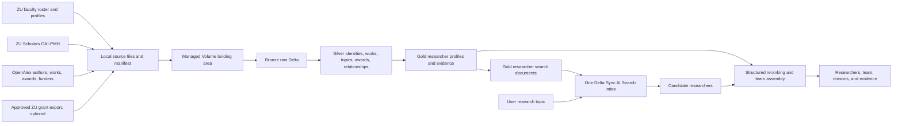

# ResearchMatch AI — Product and Data Plan

**Status:** Current source of truth  
**Last updated:** 2026-10-27
**Platform:** Databricks Free Edition  

This MVP builds evidence-based profiles of Zayed University researchers and matches a user-supplied research topic to suitable ZU collaborators or a complementary research team. Public directory observations do not establish current employment or collaboration availability; the pilot labels this limitation explicitly.

**Current implementation checkpoint:** Bronze and Silver v2 are user-confirmed in
Databricks. Silver build `3230bb0f-28c7-4830-90b5-5a21034794cb` has seven verified
researchers, 440 source links, 439 contribution groups (437 eligible), and 534 topic
rows; publication-version checks passed. The user also confirmed the seven-profile
Gold build, expected counts, freshness, zero integrity violations and CDF in
Databricks. GTE inference passed for all seven profiles, and the user confirmed
index creation on existing STANDARD endpoint `vs_endpoint_1`: seven indexed rows,
ready, processed source version 2. Notebook 12's optional column-list validation
was corrected; the user subsequently confirmed full indexed-content verification
and all 16 live search checks. These are smoke checks, not independently labelled
relevance accuracy. Notebook 13 now implements evidence-backed matching using the
same index, with explicit uncalibrated lexical screening and insufficient-evidence
responses. All 172 offline tests pass, and a full-collection evidence-policy replay
completed. The user subsequently ran notebook 13 successfully in Databricks and
provided three detailed evidence results. Review exposed topic-label-only subject
support, partial coverage and a suspected preprint/conference pair. A separate
notebook 14 now implements `matching_v2_direct_evidence`, retaining notebook 13
unchanged for comparison. It requires direct title/abstract support, separates
partial candidates and discounts same-title display/ranking support without merging
records. All 210 local tests pass; the full local replay completed for 12 smoke and
12 reserved prompts and flagged 19 unverified same-title groups. The user confirmed
notebook 14's validate/match/evaluate runs (six partial, four insufficient-evidence,
two refinement outcomes) and approved continuing to the UI pilot. Independent
relevance labels were not supplied. The reserved replay exposed
remaining lexical false positives in partial results; no accuracy claim is made.
The read-only Streamlit app is now implemented locally, reusing notebook 14's
unchanged policy and the existing SQL warehouse/index. On 2026-10-27 the idle
`vs_endpoint_1` (removed by Free Edition) was recreated under the same name and
the index rebuilt from unchanged Gold. The content scan and all 16 search checks
passed. The app was deployed as `researchmatch-pilot` with read-only grants plus
CAN_USE on the endpoint. The user confirmed the in-app connection check (7
researchers, 437 publications, 19 same-title groups) and reported good results
from their own live searches. These are pilot acceptance checks, not independent
relevance labels. All 232 tests pass locally. Do not recreate data/search resources
unless they are missing. Independent relevance review, broader profile coverage,
verified funding and team matching remain
later milestones, not completed features.

The first implementation milestone is a pilot of approximately 50 researchers across
Business and Technological Innovation: enter a topic, retrieve five relevant ZU
researchers, and inspect publication evidence for each. Historical awards are optional
enrichment. Missing funding data must not be treated as zero funding or automatically
lower a researcher's rank. Team assembly follows validated individual recommendations.

The primary collection route is now external download to immutable source files,
followed by upload to a managed Unity Catalog Volume and batch loading into Bronze.
Preserve JSON/XML/HTML; use CSV for naturally tabular institutional exports. See
[`data_collection_runbook.md`](data_collection_runbook.md) for the collector and batch contract.

## 1. Product outcome

ResearchMatch AI will answer:

> “Given this research topic, which Zayed University researchers should I collaborate with, and why?”

For every researcher, the product should show:

- current ZU role, college, and department or teaching area;
- research outputs, including articles, books, chapters, conference papers, datasets, and other repository works;
- primary and emerging research interests inferred from completed work;
- research methods or capabilities when the evidence supports them;
- historical grants and awards, with source and confidence clearly shown;
- recent activity and selected impact indicators;
- previous collaborators and interdisciplinary experience;
- links to the evidence used to construct the profile.

For every topic query, the product should return:

- ranked individual researchers;
- an optional suggested team of complementary researchers;
- concise reasons for each recommendation;
- relevant publications and grant evidence;
- confidence and data-quality indicators;
- filters such as college, campus, activity window, and team size.

## 2. MVP scope

### Included

- Active ZU faculty and research-active academic administrators.
- Adjunct faculty retained in the data and included only when product policy allows it.
- ZU faculty pages, ZU Scholars, OpenAlex, and approved institutional grant data.
- Publicly verifiable researcher identifiers and research metadata.
- Research-interest inference from structured topics, titles, abstracts, subjects, and recency.
- Topic-to-researcher retrieval using Databricks AI Search.
- Evidence-backed ranking and team assembly.
- Bronze, Silver, and Gold Delta tables in Unity Catalog.

### Not included in the MVP

- Searching for future funding opportunities.
- Matching to researchers outside Zayed University.
- Grant application writing or submission.
- Treating citation count as a measure of researcher quality.
- Claiming that public grant metadata is a complete financial record.
- Downloading publication PDFs or grant attachments without explicit permission.
- Building profiles primarily from an LLM's unsupported interpretation.

## 3. High-level architecture



## 4. Source strategy

### 4.1 Researcher roster

Source priority:

1. Official ZU HR or Office of Research export, if available.
2. Public ZU college faculty listing and profile pages.

The roster determines who is currently in scope. OpenAlex institution affiliation must not be used as proof of current employment because it includes historical, incidental, and incorrectly attributed affiliations.

Required roster fields:

- institutional researcher ID, if available;
- full name and known aliases;
- institutional email;
- college, department, campus, rank, and role;
- active/inactive status;
- ORCID and public profile URL, when available;
- effective or extraction date.

### 4.2 Research outputs

Use ZU Scholars as the institutional publication source and OpenAlex for enrichment.

ZU Scholars supplies:

- repository identifier and URL;
- title, creators, abstract, date, subjects, and content-type sets;
- DOI and public file URL when present;
- college and collection membership through OAI set specifications.

OpenAlex supplies:

- canonical work and author IDs;
- ORCID links and name alternatives;
- authorships and affiliation evidence;
- structured topic, subfield, field, and domain labels;
- abstracts where available;
- venue, work type, open-access status, citations, and publication dates;
- coauthor relationships;
- award and funder links when available.

DOI is the preferred work crosswalk. Works without DOIs require title, year, and author matching with confidence scoring.

### 4.3 Grants and awards received

Grant history needs an explicit confidence hierarchy.

| Priority | Source | Treatment |
|---|---|---|
| 1 | Approved ZU Research Office grant/award export | Authoritative confirmed award |
| 2 | Direct funder award page linked to the researcher or ZU | Confirmed public award |
| 3 | OpenAlex Award record with matching award ID, investigator, institution, or funded output | Externally evidenced; verify association |
| 4 | Structured funding acknowledgement on a publication | Publication-level funding evidence |
| 5 | Faculty biography or CV statement | Self-reported; review before confirmation |
| 6 | LLM/rule extraction from unstructured text | Candidate evidence only; never automatically confirmed |

The institutional export should contain, when approved:

- internal award ID and external funder award ID;
- project title and abstract;
- funder and funding program;
- principal investigator and co-investigators using institutional IDs;
- award amount, currency, and ZU share when disclosure is allowed;
- start date, end date, and status;
- internal/external and grant type;
- source-updated timestamp and visibility classification.

OpenAlex has a dedicated Awards API containing award title, description, funder, award ID, scheme, type, amount/currency, dates, investigators, awarded institutions, funded outputs, topics, provenance, and source URL. Its own documentation warns that award-to-work and award-to-funder matching can be incomplete. A live ZU institution query on 2026-08-20 returned only one award and its lead affiliation did not appear to be ZU, confirming that OpenAlex alone is insufficient for ZU grant history. [OpenAlex Awards documentation](https://help.openalex.org/data/awards/)

If an official ZU grant export is unavailable, the UI must say **“publicly evidenced funding”**, not **“all grants received.”** Amount totals should not be shown as complete.

## 5. Medallion data model

Use these Unity Catalog schemas:

- `workspace.researchmatch_bronze`
- `workspace.researchmatch_silver`
- `workspace.researchmatch_gold`

### 5.1 Bronze: source-faithful history

Bronze remains versioned and reprocessable. Store selected raw business payloads plus source metadata, hashes, request context, and ingestion-run IDs.

| Table | Grain |
|---|---|
| `ingestion_runs` | One source ingestion execution |
| `ingestion_errors` | One request or record error |
| `zu_faculty_pages_raw` | One fetched HTML page version |
| `zu_faculty_discovered_profiles` | One discovered profile link/version |
| `zu_scholars_oai_raw` | One OAI record version |
| `zu_grant_awards_raw` | One version of an approved institutional award record |
| `openalex_institutions_raw` | One OpenAlex institution version |
| `openalex_authors_raw` | One OpenAlex author version |
| `openalex_works_raw` | One OpenAlex work version |
| `openalex_awards_raw` | One OpenAlex award version |
| `openalex_funders_raw` | One OpenAlex funder version |

### 5.2 Silver: canonical research graph

| Table | Grain and purpose |
|---|---|
| `researchers` | One canonical ZU researcher |
| `researcher_identifiers` | One ORCID, OpenAlex, institutional, email, or repository identifier per researcher |
| `researcher_aliases` | One normalized name variant per researcher |
| `researcher_affiliations` | One affiliation period/source per researcher |
| `works` | One deduplicated research output |
| `researcher_works` | One researcher-work authorship relationship |
| `work_version_relationships` | One reviewed concept/version relationship with provenance |
| `work_contributions` | One preserved work mapped to a contribution and representative |
| `researcher_contributions` | One researcher-contribution group with eligibility/type |
| `topics` | One OpenAlex topic with hierarchy |
| `work_topics` | One work-topic score |
| `researcher_topic_scores` | One researcher-topic score by scoring version |
| `coauthor_edges` | One researcher pair with collaboration statistics |
| `funders` | One canonical funder |
| `awards` | One canonical grant/award |
| `researcher_awards` | One researcher-award role and confidence relationship |
| `award_evidence` | One source assertion supporting or contradicting an award relationship |
| `entity_resolution_review` | One ambiguous identity or award association requiring review |

Silver v1 implementation adds `authors`, `work_sources`, `work_authorships`,
`work_awards`, and `quality_issues` for structured source evidence and crosswalks.
It also adds append-only `identity_decisions` and operational `build_runs`.
Derived tables retain build snapshots; `*_current` views expose only the last
fully successful build. See [`silver_runbook.md`](silver_runbook.md) for contracts,
limits, and the exact review workflow.

Initial researcher rows are the 50 downloaded profile anchors, not yet 50 verified
distinct people. Roles and aliases at the same URL are consolidated. Cross-campus
URL merges remain flagged for subsequent resolution. OAI-only and ambiguous-DOI
works are retained without forcing identity or publication merges.

Important Silver fields:

- stable surrogate IDs independent of mutable names;
- source provenance and source record IDs;
- match method and confidence;
- first/last observed timestamps;
- verification status;
- active/current flags;
- record-quality indicators.

### 5.3 Gold: implemented verified-profile pilot

| Table | Grain and purpose |
|---|---|
| `researcher_profiles` | One verified researcher per build, directory-observed affiliations, counts and templated summary |
| `researcher_profile_publications` | One eligible representative contribution per researcher/build; 1,024 rows for 13 profiles (437 for the first seven) |
| `researcher_profile_topics` | One ranked researcher-topic score per build; 1,165 rows for 13 profiles |
| `researcher_topic_evidence` | One researcher-topic-contribution link per build; 2,803 rows for 13 profiles |
| `profile_quality_metrics` | Coverage gaps, pending candidates and unresolved-data warnings per profile/build |
| `researcher_search_document_history` | One bounded, evidence-linked search document per researcher/build |
| `researcher_search_documents` | Current generated AI Search source projection; one stable document ID per verified researcher, CDF enabled, 365-day history retention |
| `build_runs` | Frozen Silver versions, fingerprints, snapshot validation status and failures |

The six snapshot tables retain history. `current_build` and the six `*_current`
views follow the validated build actually published in the serving document table,
not simply the newest run log. One atomic serving-table MERGE publishes a projection;
there is no claim of cross-table transactions. Builds are manual and sequential.

Funding remains `not_established` with a NULL verified-award count. Gold award
summaries and separate match-feature tables are deferred until evidence/policy and
retrieval evaluation justify them. Current employment is not inferred from identity
verification. Preprints are labelled; retractions and concept aliases are excluded.
Unreviewed version relationships may remain: group counts are not certified counts
of independent studies. Same-title candidates are flagged, never automatically merged.

Gold tables must be reproducible from Silver. Human corrections belong in a governed mapping/override input, not as undocumented manual edits to Gold.

## 6. Researcher identity resolution

The roster defines the canonical person. Link evidence in this order:

1. institutional researcher ID;
2. exact ORCID;
3. exact institutional email;
4. DOI authorship with ZU affiliation and compatible name;
5. OpenAlex author ID verified by multiple works or affiliation evidence;
6. normalized name plus college, topics, and publication evidence;
7. manual review for ambiguous cases.

Do not merge researchers using name similarity alone. Common names, name order, initials, transliteration, and author-profile splitting/merging make this unsafe.

Recommended identity statuses:

- `verified`
- `probable`
- `ambiguous`
- `unmatched`
- `rejected`

Only `verified` and high-confidence `probable` links may eventually feed public
profiles. **Silver v1 uses the stricter verified-only rule:** all automatically
generated candidates, including exact profile-ORCID matches, await explicit human
review. Probable-link publication is not enabled. Ambiguous links remain evidence.

## 7. Inferring research interests

Research interests should be derived from evidence, not generated from a biography alone.

### Signals

- OpenAlex work-topic scores and topic hierarchy;
- ZU Scholars subjects;
- titles and abstracts;
- publication type;
- recency;
- authorship contribution where available;
- frequency across independent works;
- stated research/teaching areas from ZU profiles;
- topics of verified historical awards.

### Topic score

For each researcher and topic, calculate a versioned score such as:

```text
sum(
  source_topic_score
  × recency_weight
  × authorship_weight
  × work_type_weight
  × source_confidence
)
```

Recommended behavior:

- use a roughly five-year half-life so recent work matters without erasing established expertise;
- preserve an all-career score and a recent score;
- reduce the effect of extremely large consortium papers on individual expertise;
- require evidence from more than one work before presenting a topic as established expertise;
- label a topic as emerging when it is recent but has limited evidence;
- use OpenAlex topics/subfields/fields as the stable taxonomy;
- retain profile-stated interests separately so users can distinguish stated from demonstrated interests.

### Profile summary

Build a deterministic evidence bundle first. An LLM may turn that bundle into readable prose, but every sentence must be traceable to structured fields or cited works/awards. Store the prompt version, generation timestamp, source evidence IDs, and model identifier. If no suitable model is available in Free Edition, use a templated summary instead.

## 8. AI Search design

Databricks Free Edition permits one AI Search endpoint with one search unit and does not support Direct Vector Access. Use one standard Delta Sync index with managed embeddings and triggered synchronization. [Databricks Free Edition limitations](https://docs.databricks.com/aws/en/getting-started/free-edition-limitations)

### Endpoint and index

- Endpoint: `researchmatch-search`
- Index: `workspace.researchmatch_gold.researcher_profiles_index`
- Source table: `workspace.researchmatch_gold.researcher_search_documents`
- Primary key: `document_id`
- Embedding source: `search_text`
- Index subtype/query mode: hybrid semantic and keyword
- Sync mode: triggered after a successful Gold refresh
- Change Data Feed: enabled on the source Delta table
- Row grain: one document per verified pilot researcher; directory-observed affiliation, not certified active employment

A standard Delta Sync source requires Change Data Feed, and Databricks can compute managed embeddings from a text column. [Databricks AI Search creation guide](https://docs.databricks.com/aws/en/ai-search/create-ai-search)

### Implemented search document shape

| Column | Purpose |
|---|---|
| `document_id` | Stable key such as `researcher:<researcher_id>` |
| `researcher_id` | Gold/Silver join key |
| `display_name` | Result display and keyword matching |
| `college_codes_text` | Directory-observed college codes |
| `top_topics_text` | Top ten evidence-backed topic labels and support counts |
| `search_text` | Curated text sent to the managed embedding model |
| `search_text_sha256` | Content integrity hash |
| `publication_evidence_ids`, `topic_ids` | Exact evidence represented in the text |
| `eligible_contribution_count`, `eligible_preprint_count` | Contribution coverage with type labels |
| `affiliation_status`, `funding_status`, `is_searchable` | Explicit directory-observed/unknown funding and searchable status |
| `profile_url` | Evidence/display link |
| `gold_build_id`, `silver_build_id` | Published snapshot lineage and freshness |

Pilot `search_text` contains identity/coverage labels, top topics, and up to twelve
selected eligible publication titles with labelled OpenAlex abstract excerpts.
The 6,000-character limit is not a token-limit guarantee; verify the selected
embedding model later. Raw biographies, repository descriptions, citations and
unverified grant claims are not embedded. No unsupported methods or award themes
are inferred. Full publication and topic evidence stays in separate Gold tables.
The endpoint/index, managed-embedding choice and triggered sync are the next stage
after Databricks Gold validation, not part of the current builder.

Notebook 12 implements that next stage with read-only discovery as its default.
It prefers a listed `databricks-gte-large-en`, allows the longer-context Qwen3
embedding endpoint, and refuses short-context BGE for these whole-profile documents.
Model listing is not proof of Free Edition inference access: the explicit probe
must pass inside the workspace. Creation is guarded against a second endpoint or
replacement of an incompatible existing index. Exact indexed content/lineage is
checked before ANN/hybrid smoke tests. No live results are claimed yet.

## 9. Topic matching and team formation

### 9.1 Candidate retrieval

1. Accept the user's topic in natural language.
2. Optionally collect methods, desired team size, college/campus constraints, and whether the user should be excluded.
3. Query AI Search in hybrid mode against `search_text`.
4. Filter to verified searchable pilot researchers and supported user constraints;
   show directory observation/freshness rather than claiming verified active employment.
5. Retrieve a candidate pool, for example the top 20–40 researchers.

### 9.2 Structured reranking

Rerank AI Search candidates using transparent features. Initial weights are hypotheses and must be tuned through evaluation.

| Component | Initial weight |
|---|---:|
| Semantic/hybrid retrieval relevance | 55% |
| Direct structured topic overlap | 20% |
| Recent relevant work | 10% |
| Strength and number of relevant evidence works | 10% |
| Relevant verified/evidenced grant experience | 0% in the first pilot; display as optional evidence |
| Profile completeness and identity confidence | 5% |

Do not allow citations, h-index, rank, college, or grant amount to dominate matching. These signals are field-dependent and can introduce strong disciplinary bias.

Profile completeness in the pilot must exclude missing funding data. Revisit any
award-based ranking only after coverage is measured and missing data can be handled
without treating unknown funding history as lack of experience.

### 9.3 Team assembly

**Implemented (first version):** `app/researchmatch/team.py` builds a greedy
evidence-coverage team from the displayed candidates, covering items 1–3 and 5 below;
explicit role types beyond lead/complement and collaboration rewards remain future work.

When the user requests a team rather than individuals:

1. choose the strongest lead-topic match;
2. add candidates that cover missing subtopics or methods;
3. penalize near-duplicate expertise using maximal marginal relevance or an equivalent diversity rule;
4. optionally reward demonstrated cross-college or cross-topic collaboration;
5. avoid using prior coauthorship as a requirement, because the product should also enable new collaborations;
6. explain the role each proposed member could play.

Team output should distinguish:

- subject/domain lead;
- methods or technical specialist;
- complementary application-area researcher;
- optional experienced grant/project lead when verified evidence exists.

### 9.4 Match response

Each returned researcher should include:

- match score or qualitative fit band;
- two or three evidence-based reasons;
- top relevant topics;
- up to three relevant works with links and dates;
- relevant grant/award evidence with verification label;
- current college/role and profile link;
- data freshness and confidence.

Never present generated explanations without the evidence rows used to support them.

## 10. Application shape

Current first UI slice: the `app/` folder contains a read-only Streamlit app with
a topic form, optional required terms, separate direct/partial evidence lists,
publication links, preprint/possible-version warnings and build provenance. It
uses Databricks-managed app authorization and a bounded SQL Statement API adapter,
not Spark inside the app. Page load does not query data; explicit submissions
recheck current snapshots. A "Suggested team" option combines displayed evidence
coverage (§9.3), a read-only *Researcher profiles* view shows each verified profile's
topics and publications, and failures give step-specific guidance. No LLM or
persistence is introduced.
See [`app_runbook.md`](app_runbook.md). The features below remain the broader target.

The MVP can be one Databricks App with:

- a topic input box;
- optional filters and team-size control;
- individual/team result toggle;
- researcher cards;
- expandable evidence for works, awards, and topic scores;
- feedback controls such as relevant/not relevant and incorrect profile data.

The application reads candidates from AI Search and fetches full evidence from Gold Delta tables through the SQL warehouse.

Lakebase is not required for the core matching data. If saved searches, bookmarks, feedback, or user sessions are added, Lakebase may hold only that transactional app state; research profiles and matching evidence remain in Delta.

## 11. Refresh and orchestration

Recommended MVP cadence:

| Dataset | Cadence |
|---|---|
| ZU roster and public profiles | Weekly or after official roster delivery |
| ZU Scholars OAI-PMH | Weekly full reconciliation; optional bounded refreshes between full runs |
| OpenAlex works/authors | Weekly targeted re-fetch and hash comparison |
| OpenAlex awards/funders | Monthly and after new award evidence appears |
| Official ZU award export | On each approved delivery, preferably monthly or quarterly |
| Silver and Gold transforms | After successful source refreshes |
| AI Search sync | Triggered after Gold quality checks pass |

Run source downloaders outside Databricks, upload a completed manifest and source files
to the landing Volume, then use a sequential Databricks Workflow:

1. validate and load landed roster/profile pages;
2. load landed ZU Scholars records;
3. load landed OpenAlex entities;
4. load approved ZU awards when available;
5. build Silver identities and relationships;
6. run data-quality gates;
7. build Gold profiles/search documents;
8. trigger AI Search synchronization.

## 12. Free Edition design constraints

The design intentionally minimizes compute and serving resources:

- one AI Search endpoint and one researcher-profile index;
- one search row per researcher rather than one row per publication;
- triggered index synchronization instead of continuous synchronization;
- targeted OpenAlex extraction, not a global snapshot;
- incremental/hash-aware writes and serial notebook tasks;
- compact Gold tables and limited result pools;
- no custom embedding model requirement;
- no GPU dependency;
- no always-on app assumption.

Free Edition restricts outbound internet access to trusted domains. Before depending on in-workspace ingestion, test access from a Databricks serverless notebook to:

- `www.zu.ac.ae`;
- `zuscholars.zu.ac.ae`;
- `api.openalex.org`.

The selected implementation uses the controlled landing process as its primary route:
run the extractor externally, write immutable source files, upload them to a Unity
Catalog Volume, and load those files into Bronze Delta. Direct API ingestion inside
Databricks remains an alternative. Local staging improves retryability; compute savings
should be measured rather than assumed.

## 13. Data quality and evaluation

### Data quality gates

- Every active roster researcher has one stable `researcher_id`.
- No two active researchers share a verified ORCID or institutional email.
- Ambiguous author links are excluded from public profiles until reviewed.
- Every displayed topic has evidence work IDs or verified award IDs.
- Every displayed award has source, confidence, and verification status.
- Gold rows are not published when identity confidence falls below the agreed threshold.
- AI Search sync occurs only after uniqueness, null, freshness, and evidence checks pass.

### Matching evaluation set

Create a reviewed benchmark of at least 25 representative research-topic queries spanning all ZU colleges. For each query, obtain expected relevant researchers from faculty or the Office of Research.

Track:

- precision at 5;
- recall at 10;
- normalized discounted cumulative gain at 10;
- expert acceptance of the suggested lead researcher;
- expert acceptance of the proposed team;
- explanation/evidence correctness;
- college and discipline coverage;
- latency and index freshness.

Review false positives by cause: identity error, overly broad topic, stale profile, large-consortium paper, noisy keyword, or incorrect award association.

## 14. Governance and responsible use

- Show whether each interest is demonstrated, stated, or emerging.
- Show whether each grant is confirmed, externally evidenced, self-reported, unclear, or rejected.
- Restrict sensitive internal award amounts or unpublished projects using Unity Catalog permissions and product visibility rules.
- Escape and sanitize external text before rendering.
- Do not expose institutional emails beyond approved users.
- Provide a correction process for researchers.
- Preserve source provenance and scoring/model versions.
- Avoid ranking language such as “best researcher”; describe relevance to the submitted topic.
- Audit coverage differences across arts, humanities, social sciences, health, business, and technology.

## 15. Implementation phases and exit criteria

### Phase 0 — access and scope gates

Tasks:

- confirm the definition of active researcher and adjunct inclusion;
- obtain or define the official roster delivery;
- request the ZU grant/award export and its approved visibility fields;
- test Databricks outbound connectivity;
- inventory which managed embedding model is available in the workspace.

Exit criteria:

- authoritative roster path agreed;
- grant-history claim is labeled appropriately;
- source connectivity or landing fallback proven.

### Phase 1 — Bronze ingestion

Tasks:

- revise the Bronze DDL for historical awards;
- collect the two-college pilot, repository metadata, and targeted OpenAlex enrichment;
- treat institutional awards as optional until an approved export exists;
- implement manifest validation and Volume-to-Bronze loading;
- implement run/error logging, hashes, retries, and idempotency;
- complete initial full harvests.

Exit criteria:

- raw records are reproducible and traceable;
- repeat runs do not create duplicate versions;
- source counts and completeness checks are recorded.

### Phase 2 — Silver research graph

Tasks:

- parse and deduplicate works;
- resolve roster researchers to repository/OpenAlex identities;
- normalize authorships, topics, funders, and awards;
- create evidence and manual-review queues;
- compute coauthor edges.

Exit criteria:

- agreed identity-resolution coverage achieved;
- ambiguous matches isolated;
- award claims carry verification labels.

### Phase 3 — Gold profiles

Tasks:

- compute recent and all-career topic scores;
- select representative publication and award evidence;
- build profile summaries and matching features;
- create one search document per researcher;
- run quality gates.

Exit criteria:

- every profile statement is evidence-backed;
- representative faculty review approves sample profiles.

### Phase 4 — AI Search and matching

Tasks:

- enable Change Data Feed on the search-document table;
- create the one standard endpoint and Delta Sync hybrid index;
- implement candidate retrieval, simple reranking, and filters;
- evaluate 15–20 representative topics using expert judgments of the top five results;
- tune weights from evaluation, then implement complementary team suggestions;
- return evidence with every match.

Exit criteria:

- benchmark precision and expert-acceptance targets are agreed and met;
- sync and query work within Free Edition limits.

### Phase 5 — Databricks App

Tasks:

- implement topic search and team-size controls;
- display researcher cards and evidence;
- add feedback/correction capture;
- document refresh status and known coverage gaps.

Exit criteria:

- end-to-end user acceptance with representative ZU users;
- no unsupported grant or expertise claims;
- operating runbook completed.

## 16. Changes to the existing implementation

Keep:

- `zu_scholars_oai_raw` design;
- ingestion-run and ingestion-error tables;
- the ZU Scholars OAI notebook;
- OpenAlex institution/author/work raw table concepts;
- source hashes and versioned raw records.

Completed in the Bronze DDL:

- added `zu_grant_awards_raw`;
- added `openalex_awards_raw` and `openalex_funders_raw`.

Completed in local source collection:

- built resumable faculty, OAI, and OpenAlex downloaders with manifests and checksums;
- collected the two-college pilot and associated public metadata;
- created a verified transfer archive and recorded coverage gaps in
  [`collection_report_2026-09-05.md`](collection_report_2026-09-05.md).

Completed for the Volume-to-Bronze route:

- user uploaded both batches to `/Volumes/workspace/researchmatch_bronze/landing/`;
- implemented a self-contained, manifest-driven notebook with checksum validation,
  bounded load settings, insert-only version merges, and operational logs;
- validated adapters against the complete local collection; the user subsequently
  confirmed successful full Delta loads and duplicate-key checks in Databricks.

Completed for Silver v1 (2026-09-07):

- user confirmed successful full Bronze loads and no duplicate version keys;
- implemented SQL 04, a self-contained default-validate notebook 05, and review SQL 06;
- added explicit identity decisions, conservative DOI-based enrichment, raw-source
  authorships, topic evidence, and unresolved award links without personal grant claims;
- added successful-build publication views, resource guards, offline tests, and a
  complete local collection replay (50 profile anchors, 123 identity candidates,
  13,557 work records before identity approval);
- retained retracted records but excluded them from positive expertise evidence.

Completed for Silver v2 and the local Gold pilot (2026-09-18 checkpoint):

- user confirmed seven accepted identities and successful contribution-level
  Silver build `3230bb0f-28c7-4830-90b5-5a21034794cb`;
- preserved both Zenodo source records while using the reviewed version once;
  SQL 08 checks returned zero violations, with 439 groups and 437 eligible groups;
- implemented Gold SQL 09, self-contained default-validate notebook 10, review
  SQL 11 and the runbook; no new Silver identity decisions are made;
- replayed the full collection locally: seven profiles, 437 publication evidence
  rows, 534 topics, 1,170 topic-evidence links and seven search documents;
- passed 107 offline tests at the Gold checkpoint; the user subsequently confirmed
  successful Gold Spark/Delta execution and all SQL 11 checks;
- implemented notebook 12 for model discovery, inference probes, one STANDARD
  endpoint/triggered Delta Sync index, exact content checks and eight-topic ANN/hybrid
  evaluation. The user subsequently confirmed model probes, index creation,
  full content verification and all 16 live query checks.

Completed locally for evidence-backed matching (2026-09-18):

- implemented self-contained notebook 13, reusing the existing seven-profile index
  and version-pinned Gold publication/topic evidence without writes or new resources;
- added explicit contribution-level evidence screening, required-term support,
  preprint/source-topic provenance, partial-coverage labels and cautious abstention;
- added compact smoke evaluation and a separate human review template;
- passed 172 offline tests and replayed all 12 smoke topics against the full local
  evidence collection. Synthetic candidate ordering is not live AI Search validation;
- versioned the provisional policy as `matching_v1_explicit_evidence`: 60% specific
  anchor coverage per contribution, with title/source-topic support. Ranking uses
  title coverage, combined evidence coverage, query coverage and bounded support
  count. Weights and thresholds require human calibration; scores are not probabilities.

Still to implement or validate:

- review pilot identity candidates and unresolved source references;
- verify the unchanged-input repeat-build skip in Databricks if not already checked;
- expand the reviewed subset of researcher–OpenAlex links and verify derived relationships;
- resolve remaining cross-campus profile duplicates and ambiguous work/identity mappings;
- implement approved institutional awards and researcher-award attribution when available;
- deploy the private read-only app and validate its own service-principal permissions;
- independently review matching evidence and held-out topics before broader release;
- evaluate actual app SQL latency/quota use before adding any cache or stateful features.

## 17. Immediate next task

The app is deployed and user-confirmed with 13 verified researchers. Next, as
chosen by the user (no independent reviewer yet): **team suggestions** built from
displayed evidence coverage (§9.3), then **anonymous feedback capture** stored as app
state in Lakebase (§10). Use
[`matching_evaluation_review.md`](matching_evaluation_review.md) for independent
relevance judgements before claiming quality. Do not advertise unreviewed profiles
as verified matches or preprints as peer-reviewed articles.

Notebook 13 stays unchanged. In notebook 14, source topic labels are review context
only. Full-query candidates require all interpreted terms in one title/abstract;
partial results remain separate, and required terms must be directly supported.
Same-title records are flagged as unverified possible versions, displayed once and
discounted for ranking support, never merged in Delta. This can increase false
abstentions; do not claim validated accuracy from passing tests or familiar topics.

The pilot covers 13 verified researchers (batches 01–03). The remaining 110
identity candidates stay pending; coauthor edges and researcher-award links
remain empty. Gold funding is unknown, not zero. Current employment and
collaboration availability remain unverified directory observations.
Hold ambiguous split author IDs and cross-campus profile duplicates for separate
review. Profile grant statements are a future evidence-extraction task, not grounds
to populate verified researcher-award rows automatically.
The existing direct OAI notebook remains available but is not the selected workflow.

## References

- [ZU Scholars OAI-PMH](https://zuscholars.zu.ac.ae/do/oai/?verb=Identify)
- [OpenAlex API reference](https://help.openalex.org/api/)
- [OpenAlex Awards](https://help.openalex.org/data/awards/)
- [OpenAlex Funders](https://help.openalex.org/data/funders/)
- [Databricks Free Edition limitations](https://docs.databricks.com/aws/en/getting-started/free-edition-limitations)
- [Create Databricks AI Search endpoints and indexes](https://docs.databricks.com/aws/en/ai-search/create-ai-search)
